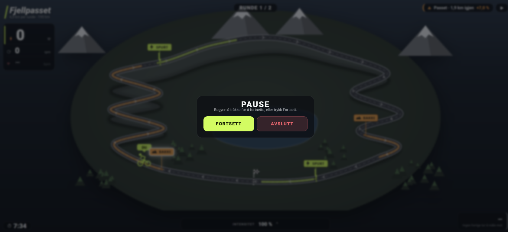

# Rundløype

Rundløype er en **frittstående nettleserapp for smart-rulle** med fokus på rundløyper,
bakker, spurtsoner og konkurranse mot din egen forrige tur. Velg en av tre lukkede løyper,
antall runder og intensitet, og kjør mot en gjennomsiktig «ghost» av forrige gang du syklet
samme løype. Alt lagres lokalt i nettleseren – ingen konto, ingen backend, ingen eksterne kall.

Appen er en fork av [Auuki](https://github.com/dvmarinoff/Auuki) av Dimitar Marinov og
bygger på Auukis Bluetooth-stack, fysikkmodell, FIT-koder og innstillinger. Se
[Lisens og kreditering](#lisens-og-kreditering).

## Funksjoner

**Velg løype**
* Tre fiktive rundløyper med forhåndsvisning, lengde, høydemeter og høydeprofil:
  * **Fjordrunden** – 4,2 km, 37 hm. Lett og rask, to små kneiker og én spurt.
  * **Skogsringen** – 4,8 km, 110 hm. Kupert, to skikkelige bakker og en lang spurtstrekning.
  * **Fjellpasset** – 6,5 km, 195 hm. Lang stigning (opptil 9,7 %) med hårnålssvinger, to spurter.
* 1–4 runder, intensitet 50–150 %, ghost av/på. Sveip mellom løypekortene på mobil.
* Historikk over alle turer, med .fit-nedlasting og sletting. Ingen begrensning i antall.

**Underveis**
* Hele løypa i lett isometrisk 2.5D-perspektiv der veien løftes etter høyden; syklist og ghost
  følger veien nøyaktig.
* Oransje BAKKE-skilt og limegrønne SPURT-porter på riktig sted, start-/mållinje, rundeteller.
* Store tall for watt, kadens og tid; puls når tilgjengelig.
* Varsel om neste bakke/spurt med avstand, stigning og høydemeter. Tidsforskjell mot forrige tur.
* Sammenleggbart overlay med intensitet, høydeprofil med posisjonsmarkør og store
  pause-/avsluttknapper. Korte tilbakemeldinger ved fullført bakke, spurt og runde.
* Fullskjerm og låst liggende skjerm på berøringsenheter. Stående skjerm fungerer også.

**Etterpå**
* Rundetider og bakke-/spurttider sammenlignet med forrige tur, snitt/maks watt, puls, kadens,
  distanse og høydemeter. .fit-eksport.

## Kjøre lokalt

```sh
npm install
npm start            # http://localhost:1234
npm run build        # statisk bygg i dist/ (Cloudflare Pages: build "npm run build", output "dist")
npx jest test/race   # tester for løypegeometri, intensitet, ghost og race-motor
```

Bruk Chrome/Edge med Bluetooth (Android: Chrome). Koble til rulla med «Rulle»-knappen øverst,
eventuelt pulsbelte med «Puls». Vekt og FTP settes under tannhjulet (Innstillinger) – vekten
brukes i fysikkmodellen. Testet med Elite Zumo (FTMS).

**Uten rulle:** åpne `http://localhost:1234/?demo=1` for en simulert rytter.
`?demo=1&warp=40` legger på 40 m/s ekstra for å spole gjennom runder under testing.

## Slik fungerer løypemodus

* **Løyper** er definert som data i [src/race/courses.js](./src/race/courses.js): kontrollpunkter for
  veien, høydeprofil per meter og navngitte segmenter (bakke/spurt). Alt som tegnes,
  posisjoneres og sendes til rulla, beregnes fra denne ene definisjonen i
  [geometry.js](./src/race/geometry.js), slik at kart, høydeprofil og simulering alltid stemmer.
* **Fremdrift** kommer fra målt watt gjennom Auukis fysikkmodell (`virtualSpeedCF`), ikke fra
  svinghjulsfarten. Fysikken bruker alltid løypas *ekte* stigning.
* **Belastning**: rulla settes i simuleringsmodus (FTMS «Simulation Parameters»), og
  stigningen oppdateres hvert sekund med jevn overgang (maks 2 %/s) og ~8 m «lookahead».
* **Intensitet** (50–150 %, steg 5) skalerer **bare** stigningen som sendes til rulla:
  `sendt = løypestigning × intensitet / 100`, klemt til −8…+12 %. 100 % er løypa slik den er
  tegnet. Farten i løypa påvirkes ikke direkte, så alle turer på samme løype er sammenlignbare
  – lavere intensitet gjør det bare lettere å holde høyere watt. Elite Zumo simulerer maks
  ~12 %, derfor klemmes bratte partier ved høy intensitet (vises som «rullegrense» i appen).
* **Spurtsoner** endrer ikke belastningen; de er en invitasjon til innsats og får egen tid.
* **Autopause** skjer ved stillstand (fart ≈ 0 og 0 W i 5 s), ikke bare ved 0 W, slik at
  nedoverbakker uten tråkk ikke stopper klokka. Gjenopptas automatisk når du tråkker.
* **Ghost** er forrige *fullførte* tur på samme løype med samme antall runder. Posisjon per
  sekund lagres i IndexedDB (`rides`) uten antallsbegrensning. Mangler sammenligningsgrunnlag,
  sies det tydelig i løypevalget.
* **Etter økta**: rundetider, bakke-/spurttider og snitt vises, og .fit-filen kan lastes ned
  (Auukis FIT-koder). Historikken ligger under løypevalget.

Koden for løypemodus ligger i [src/race/](./src/race/). Auukis opprinnelige sider
(ERG-/workout-visning) finnes fortsatt i koden, men er skjult fra menyen. Innlogging,
Strava/Intervals/TrainingPeaks og Cloudflare Turnstile er deaktivert via `OFFLINE: true` i
[src/models/config.js](./src/models/config.js).

## Lisens og kreditering

Dette prosjektet er en **modifisert versjon** av [Auuki](https://github.com/dvmarinoff/Auuki),
Copyright © Dimitar Marinov ([@dvmarinoff](https://github.com/dvmarinoff)), lisensiert under
[GNU Affero General Public License v3.0](https://www.gnu.org/licenses/agpl-3.0.en.html).

I samsvar med AGPL-3.0:
* Denne forken er lisensiert under samme lisens, AGPL-3.0. Se [LICENSE.txt](./LICENSE.txt).
* Fullstendig kildekode for den modifiserte versjonen er tilgjengelig i dette repoet,
  og det er lenket til fra «About» i appen (Innstillinger).
* Endringene fra originalen fremgår av git-historikken. Oppsummert: ny løypemodus under
  `src/race/`, frakobling av Auukis backend/konto/integrasjoner, system-font i stedet for
  Google Fonts, fjernet 7-aktiviteters-grensen, og små feilrettinger i fysikkmodell og
  workout-graf.
* Opprinnelige opphavsrettsmerknader, lisens og kreditering er beholdt.

Auuki er bygget på: [FIT SDK](https://developer.garmin.com/fit/overview/)-profiler, Martin et
al. sin sykkelfysikkmodell, og Web Bluetooth. Konseptbildet som ga visuell retning er laget
av prosjekteieren.

---

# Auuki (original README)
Auuki is a powerful, no-nonsense app built for hammering out **structured workouts** on a smart trainer, right in your browser. No installs, no dependencies, no slow updates taking from precious training time.

**Key Features**:
* Run Zwift **.ZWO workouts**
* Connect via **Bluetooth** to smart trainers, power meters, heart rate monitors, the moxy monitor, and many more
* Full control with **ERG mode**, **Grade Simulation**, and **Resistance mode**
* Workouts with **Slope-based targets** for realistic effort control
* Record **.FIT activities** in a cross-industry standard
* Recording of native **RR intervals** in the .FIT file
* Built-in structured workouts to get you started
* **Intervals.icu and Strava** integrations for seamless syncing and uploads

Built as a **progressive web app (PWA)**, Auuki is fully browser-based and runs independently. It makes use of some of the most advanced Browser APIs like: Web Bluetooth, Web Serial, and Web Components. The web version is **free and open-source**, keeping everything on your device.
Train anywhere, with full control directly in your browser.

_Status_: Currently working on creating a full suite of Apple platform native apps (iOS, iPadOS, tvOS, watchOS).

# The Web App
- You can find the web app at [auuki.com](https://auuki.com)
- There is also a special development version which has the latest features available for preview: [dev.auuki.com](https://dev.auuki.com)
- [How to create a Profile and Connect Intervals.icu](https://forum.intervals.icu/t/auuki-com-intervals-icu-integration/87105)

## Sponsors 💖
So, if you’re loving what Auuki’s bringing to the table, consider supporting the project on [GitHub Sponsors](https://github.com/sponsors/dvmarinoff)? Think of it as buying me a coffee or, heck, a whole power meter to keep this thing cranking. Hit that sponsor button and let’s keep the good times rolling!

## Supported Browsers and Platforms

### MacOS, Windows, Andorid 

Please use either Chrome, Edge, Opera, Samsung Internet, or Brave. These browsers include built-in bluetooth.

| Chrome | Edge | Opera | Chrome Android | Samsung Internet | Brave | Firefox | Safari | Safari iOS | Chrome iOS |
|--------|------|-------|----------------|------------------|-------|---------|--------|------------|------------|
| yes    | yes  | yes   | yes            | yes              | yes*  | no      | no     | no         | no         |

If using Brave browser, you'll need to [manually enable bluetooth support](https://community.brave.com/t/can-you-enable-web-bluetooth-api-in-brave/522553/2).

### Linux
On Linux you might need to turn on the experimental platforms feature flag in your browser:

- Chrome: `chrome://flags/#enable-experimental-web-platform-features`

- Edge: `edge://flags/#enable-experimental-web-platform-features`

- Opera: `opera://flags/#enable-experimental-web-platform-features`

### iOS
Not Supported by the Web version

## Supported Trainers

### FTMS, FE-C over BLE, or WahooCPS

Works with all trainers that implement the bluetooth Fitness Machine Service (FTMS) or the Tacx FE-C over BLE solution.

The following table is copied from [DC Rainmaker Trainer Guide](https://www.dcrainmaker.com/2020/11/smart-cycle-trainer-recommendations-guide-winter.html/#technical-considerations) and shows current protocol support across the industry.

```
- Elite:    ANT+ FE-C and Bluetooth FTMS on all 2020 smart trainers.
- Gravat:   ANT+ FE-C and Bluetooth FTMS on all 2020 smart trainers
- JetBlack: ANT+ FE-C and Bluetooth FTMS on all 2020 smart trainers.
- Kinetic:  ANT+ FE-C and Bluetooth FTMS on all 2020 smart trainers.
- Minoura:  ANT+ FE-C and Bluetooth FTMS on all 2020 smart trainers.
- Saris:    ANT+ FE-C and Bluetooth FTMS on all 2020 smart trainers.
- STAC:     ANT+ FE-C and Bluetooth FTMS on all 2020 smart trainers.
- Tacx:     ANT+ FE-C on all ‘Smart’ branded trainers (except Satori). FTMS on all non-NEO models. FEC over BLE on NEO.
- Wahoo:    ANT+ FE-C on all smart trainers. FTMS on all 2020 smart trainer.
- 4iiii:    ANT+ FE-C and Bluetooth FTMS on Fliiiight (--Ed)
- Schwinn:  Bluetooth FTMS on the IC8 / 800IC (--Ed)
```

### ANT+

Support for ANT+ is experimental at the moment. It is being rewritten right now and the code is moved to [WebANT](https://github.com/dvmarinoff/WebANT), which has a separate demo. When it becomes stable enough will be merged here. It currently has support for Ubuntu(Linux), and partially for MacOS, and Android. Windows 10 may be possible in the future.


The current development setup is using Suunto movestick mini, Garmin Fenix 5 watch broadcasting heart rate,
Tacx Heart Rate monitor, Tacx Flux S trainer, and X240 laptop with Ubuntu 20.04.2 LTS, M1 Mac, and Samsung S9 Android phone.

## Manual
- [How to create a Profile and Connect Intervals.icu](https://forum.intervals.icu/t/auuki-com-intervals-icu-integration/87105)
- [How-To: Using the connection settings](https://github.com/dvmarinoff/Auuki/discussions/91)
- [How-To: Using Auuki and another app concurrently](https://github.com/dvmarinoff/Auuki/discussions/101)

## Backers
<div>
    <a href="https://github.com/KlausMu" target="_blank">
        
    </a>
    <a href="https://github.com/TClin76" target="_blank">
        
    </a>
    <a href="https://github.com/fvolcic" target="_blank">
        
    </a>
    <a href="https://github.com/napfbike" target="_blank">
        
    </a>
    <a href="https://github.com/sharalds" target="_blank">
        
    </a>
    <a href="https://github.com/BenSimpsonAnalytics" target="_blank">
        
    </a>
</div>
